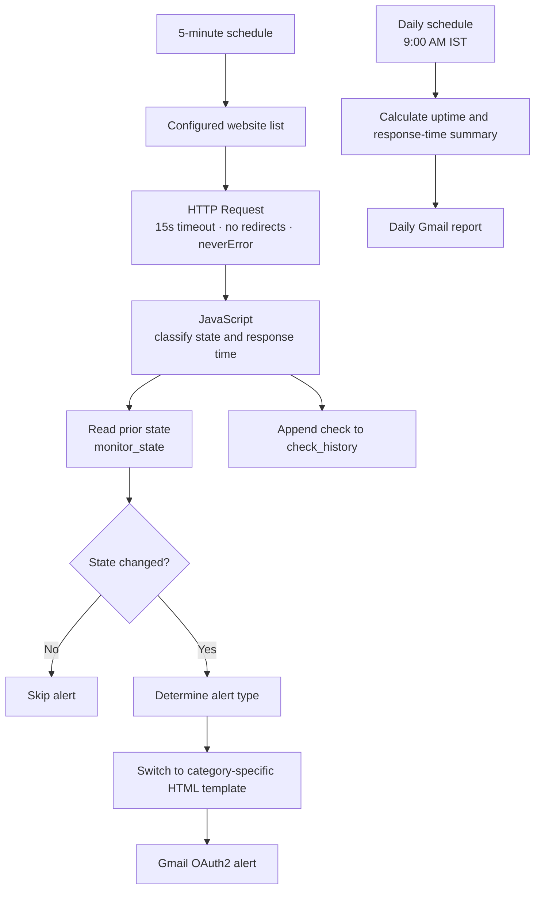
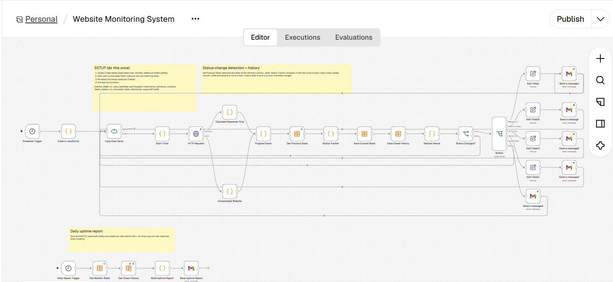

# Website Monitoring & Alerting System

<p align="center">
  <strong>Automated website health checks, state-aware alerts, and daily uptime reports — built with n8n.</strong>
</p>

<p align="center">
  
  
  
  
</p>

<p align="center">
  <a href="./Project_demo_video.mp4">🎬 Demo video</a> ·
  <a href="./Website_Monitoring_Project_Documentation.pdf">📘 Project documentation</a> ·
  <a href="./Website%20Monitoring%20System.json">📦 Importable workflow</a>
</p>

---

## Overview

A portfolio project that monitors six websites every five minutes using an n8n workflow. It measures response time, classifies each result, records check history, and sends email alerts when a monitored site's state changes. A separate daily workflow sends an uptime and response-time report.

The HTTP Request node uses a 15-second timeout, does not follow redirects, and uses `neverError` so HTTP status codes can be captured for classification. DNS, timeout, and connection failures are handled as unreachable results.

## Key Features

- 🔍 Checks six configured websites every five minutes — about 1,700 checks per day.
- ⚡ Grades response time: **Fast** (`<500ms`), **Normal** (`<1s`), **Slow** (`1–3s`), or **Very Slow** (`>3s`).
- 🧭 Classifies results as **UP** (2xx), **Redirect** (3xx), **HTTP Error** (4xx), **Server Error** (5xx), or **Unreachable** (DNS/timeout/connection failure).
- 🧠 Compares the latest result against the saved state in `monitor_state` to avoid duplicate alert emails.
- 📬 Handles `INITIAL_PROBLEM`, `WENT_DOWN`, `RECOVERED`, and `STATUS_CHANGED` transitions.
- ✉️ Routes notifications to category-specific HTML templates with recommended actions.
- 🕒 Recovery emails include downtime duration, all-time uptime percentage, and incident count.
- 🗂️ Appends every check to `check_history`.
- 📈 Sends a daily report with 24-hour and all-time uptime, average and maximum response time, incidents, and last status change per site.

## How It Works



1. On each scheduled run, the workflow checks each URL in the configured website list.
2. The result is classified by HTTP status or connectivity outcome, and response time is graded.
3. The workflow reads the saved site state and compares it with the current result.
4. If the state changed, the workflow selects an alert type and sends the matching HTML email. Unchanged states do not generate alerts.
5. Every check is appended to `check_history`; the daily branch calculates and emails its uptime summary.

## Alert Types

| State | Trigger | Email sent |
|---|---|---|
| `INITIAL_PROBLEM` | A site's first recorded result is problematic | Initial problem alert |
| `WENT_DOWN` | A previously healthy site enters a problem state | Downtime alert |
| `RECOVERED` | A site returns to `UP` after a problem | Recovery email with downtime and uptime details |
| `STATUS_CHANGED` | A site's non-UP category changes | Updated status alert |

## Tech Stack

| Technology | Use |
|---|---|
| n8n | Workflow scheduling, routing, and automation |
| JavaScript | Classification, state-change logic, and reporting calculations in Code nodes |
| n8n Data Tables | Persistent current state and check history |
| HTTP Request node | Website checks with explicit timeout and response handling |
| Gmail OAuth2 | Alert and report delivery |
| HTML email templates | Category-specific notifications and recommended actions |

## Data Table Schemas

### `monitor_state`

| Column | Description |
|---|---|
| `url` | Monitored website URL |
| `name` | Display name for the website |
| `lastState` | Most recently stored state |
| `lastChangeAt` | Time of the last state change |
| `totalChecks` | Total checks recorded for the site |
| `upChecks` | Checks recorded with an UP state |
| `incidents` | Incident count |

### `check_history`

| Column | Description |
|---|---|
| `url` | Monitored website URL |
| `checkedAt` | Check timestamp |
| `state` | Classified result |
| `statusCode` | HTTP response status code, when available |
| `responseTimeMs` | Response time in milliseconds |

## Setup & Installation

1. In n8n, create two Data Tables named `monitor_state` and `check_history`, using the schemas above.
2. Import [`Website Monitoring System.json`](./Website%20Monitoring%20System.json) into your n8n instance.
3. Open each Data Table node and select the corresponding table.
4. Connect and authorize your Gmail OAuth2 credentials for sending emails.
5. Edit the websites array in the workflow's JavaScript Code node.
6. Set the recipient email address in the email nodes.
7. Check the schedule and timezone settings, then activate the workflow.
8. Confirm the first check results and verify that state changes produce the expected notifications.

## Configuration

### Add or remove websites

Edit the websites array in the JavaScript Code node. Keep the objects consistent with the fields the workflow uses; for example:

```javascript
const websites = [
  { name: "Portfolio", url: "https://example.com" },
  { name: "API", url: "https://api.example.com" }
];
```

### Change the monitoring interval

Edit the monitoring workflow's Schedule Trigger in n8n. The configured interval is every 5 minutes.

### Change the report time or timezone

Edit the daily report workflow's schedule and timezone in n8n. The configured report time is 9:00 AM IST; use the timezone setting appropriate for your deployment (for example, `Asia/Kolkata`).

## Screenshots

### Monitoring workflow




### Daily report workflow


## Project Structure

```text
.
├── Website Monitoring System.json
├── Website_Monitoring_Project_Documentation.pdf
├── Project_demo_video.mp4
├── workflow.png
├── WorkFlow Part 1.png
├── WorkFlow Part 2.png
├── Daily Uptime report Workflow.png
├── LICENSE
└── README.md
```

## Future Improvements

- 💬 Slack or Telegram alerts
- 🌐 Public status page
- 🔐 SSL certificate expiry checks
- 🔎 Keyword and page-content validation
- 👥 Multi-recipient alert routing

## Author

**Krish Gupta** — [GitHub: Krish-Gupta123](https://github.com/Krish-Gupta123)

## License

This project is available under the [MIT License](./LICENSE).
